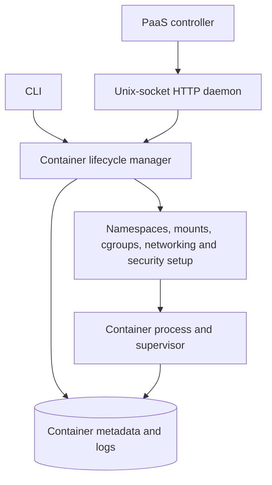

# Mini-Docker

[](https://github.com/Yumekaz/Mini-Docker/actions/workflows/tests.yml)
[](https://github.com/Yumekaz/Mini-Docker/actions/workflows/root-runtime.yml)
[](LICENSE)

**A lightweight Linux container runtime built from scratch in Python.**

Mini-Docker manages containers through Linux namespaces, cgroups, mounts, networking, seccomp and capabilities. The core lifecycle uses Python, `ctypes`, libc and Linux userspace interfaces—not Docker, containerd or runc. A Unix-socket HTTP daemon lets a control plane manage the same runtime.

It is the runtime foundation for [Cairn](https://github.com/Yumekaz/Cairn), with [DuraFlow](https://github.com/Yumekaz/DURAFLOW) integration for durable execution.

## Capabilities

| Area | Implemented surface |
| --- | --- |
| Lifecycle | Create, start, stop, restart, remove, inspect, exec and logs |
| Isolation | PID, UTS, mount, IPC, network, user and cgroup namespaces |
| Resources | cgroups v2 CPU, memory and PID limits |
| Filesystem | OverlayFS copy-on-write with chroot fallback |
| Networking | Bridge/veth setup, NAT and host port publishing |
| Security mechanisms | seccomp-BPF filtering, capability reduction and NO_NEW_PRIVS |
| Integration | Unix-domain-socket HTTP API |
| Additional paths | Pod-style namespace sharing, basic OCI bundles and a local Imagefile builder |

These mechanisms are implemented, but their availability and enforcement depend on host configuration. Mini-Docker is not an independently audited runtime for arbitrary hostile multi-tenant workloads.

## Quick start

Requirements: Linux, Python **3.8+**, and root for the full runtime path. Full networking uses `ip` and `iptables`; filesystem/runtime checks also use host tools such as `mount` and `chroot`. A kernel with the needed namespaces, cgroups v2 and filesystem support is required.

```bash
git clone https://github.com/Yumekaz/Mini-Docker.git
cd Mini-Docker
sudo ./scripts/setup.sh
python3 -m mini_docker --help
sudo python3 -m mini_docker run ./rootfs /bin/echo "Hello from Mini-Docker"
```

The setup script prepares host runtime prerequisites. For rootfs repair without changing host networking or cgroups:

```bash
./scripts/setup.sh --rootfs-only
```

Inspect host compatibility before starting workloads:

```bash
python3 -m mini_docker doctor
python3 -m mini_docker doctor --rootless
```

## Architecture



The daemon owns its listener; container supervisors do not retain that socket. Lifecycle state, exit information and logs remain inspectable across runtime operations.

## Run services and resource-limited commands

```bash
sudo python3 -m mini_docker run -d --name worker ./rootfs /bin/sleep 3600
sudo python3 -m mini_docker ps -a
sudo python3 -m mini_docker logs worker

sudo python3 -m mini_docker run --memory 100M --cpu 50 --pids 20 ./rootfs /bin/echo limited
```

To publish a real HTTP listener, use a rootfs containing BusyBox HTTP and provide readable content under `/www`:

```bash
sudo python3 -m mini_docker run -d --name web-server --publish 8080:80 \
  ./rootfs /bin/busybox httpd -f -p 80 -h /www
```

Port publishing does not start an application server by itself.

## Control-plane API

```bash
sudo python3 -m mini_docker daemon --socket /var/run/mini-docker.sock
```

The socket defaults to **0660**. Give only trusted controllers access to its owner/group: access to a root-mode runtime is security-sensitive. Modes granting access to other users warn unless explicitly acknowledged with `--insecure-socket-mode`; that override is not recommended for normal use.

| Method | Endpoint | Purpose |
| --- | --- | --- |
| GET | /containers/json | List containers |
| GET | /containers/{id}/json | Inspect a container |
| POST | /containers/create | Create a container |
| POST | /containers/{id}/start | Start |
| POST | /containers/{id}/restart | Restart |
| POST | /containers/{id}/stop | Stop |
| DELETE | /containers/{id} | Remove |

## Rootless mode

```bash
python3 -m mini_docker run --rootless ./rootfs /bin/echo rootless
scripts/runtime-smoke.sh --rootless
```

Rootless execution uses user namespaces. Bridge networking, strict cgroup enforcement and OverlayFS may need additional host support or privilege. A successful root-mode proof is not evidence for every rootless host.

## Development and verification

```bash
python3 -m venv .venv
. .venv/bin/activate
python -m pip install -e ".[dev]"
python -m pytest
```

Installing the package also provides the `mini-docker` console command.

CI includes the Python-version test matrix, strict formatting/security checks, and **Root Runtime Validation on pushes and pull requests**, with manual dispatch also available. The privileged workflow runs actual namespace/container cases and rejects prerequisite skips, using guarded disposable state paths.

The October 8 retained local suite passed **97 tests**, including five real privileged integration cases. DuraFlow separately checked command execution, environment handling and timeout cancellation. See [Cairn's validation record](https://github.com/Yumekaz/Cairn/blob/main/docs/VALIDATION_2026-10.md) for provenance and limits.

## Cleanup and hardening

Preview runtime leftovers without removing them:

```bash
python3 -m mini_docker cleanup --runtime --dry-run
```

Further hardening includes broader hostile-workload testing, rootless coverage, image provenance, supply-chain validation and independently reviewed tenant isolation. Do not expose this runtime as an open public compute service based only on the existing tests.

## Source map

| Module | Responsibility |
| --- | --- |
| cli.py / daemon.py | CLI and HTTP integration |
| container.py / metadata.py | Lifecycle and persisted state |
| namespaces.py / cgroups.py | Isolation and resource limits |
| filesystem.py / network.py | Mounts and networking |
| seccomp.py / capabilities.py | Process security mechanisms |
| pod.py / oci.py | Shared namespaces and OCI paths |

## License

[MIT](LICENSE).
